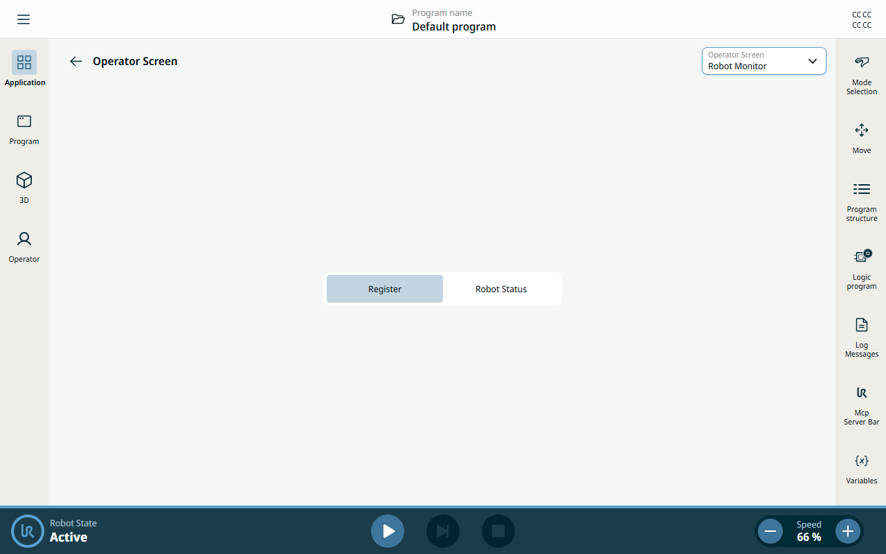
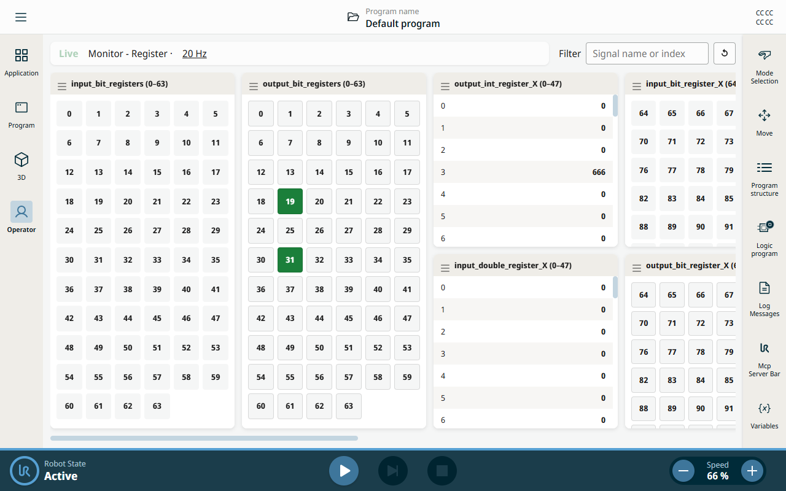
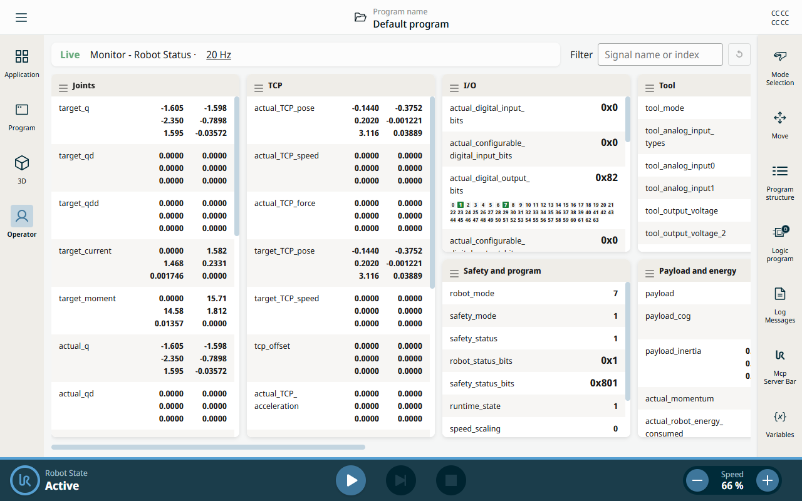
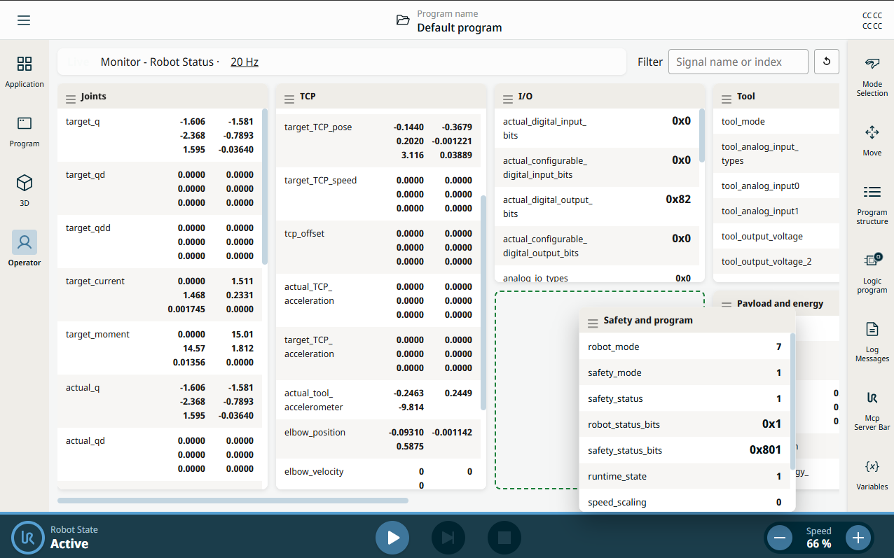

# RTDE Monitor

PolyScope X URCap that shows RTDE general-purpose registers and the remaining controller outputs on one Operator Screen.

The field names follow the [RTDE Guide](https://docs.universal-robots.com/tutorials/communication-protocol-tutorials/rtde-guide.html).

| | |
| --- | --- |
| Tested on | PolyScope X 10.15 |
| SDK | 0.22.142 |
| Author | FuNing Hu |
| Released | 2026-Nov-13 |
| Last modified | 2026-Nov-13 |
| URCap | funh / rtde-monitor 1.0.2 |

Download the built URCap from the [releases page](https://github.com/FuNingHu/RTDE-Monitor-X/releases).

## Choose the page

Application > Operator Screen lists one entry, Robot Monitor. The configuration page has a segment selector. Register is selected by default. Robot Status shows the other controller outputs. The Operator Screen follows that choice.



## Register

The Register page lists the general-purpose RTDE registers. Bit registers are a grid of cells, and a cell turns green when the bit is 1. Output bits, integers, and doubles can be changed from this page. The filter matches a name or an index, and the Hz label sets the sample rate for this page.



## Robot Status

Robot Status shows the controller outputs that are not general-purpose registers, including joints, TCP, I/O, safety, tool, payload, and controller fields. A value whose name ends in `_bits` stays hexadecimal until it is clicked, which opens a small cell for each bit.



## Rearrange the cards

Hold a card header and drag it. Dropping it on another card swaps the two positions. Dropping it on an empty position moves the card there. Each page keeps its own order and scroll position.



## Build and install

Install the dependencies, then build. A rebuild is required before a source change appears on the robot. Start URSim before installing there.

```shell
npm install
npm run build
```

Install the built URCap on URSim:

```shell
npm run install-urcap
```

Install it on a robot:

```shell
npm run install-urcap -- --host <robot_ip_address>
```
